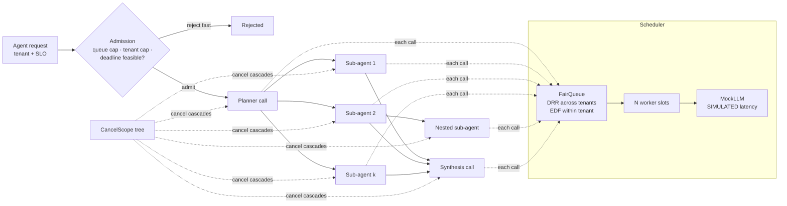

# agent-scheduler

A scheduler for agent workloads: root-level admission control, deadline propagation through sub-agent calls, cancellation trees (cancel a parent → every child stops), and deficit-round-robin fair queueing across tenants. A load test drives it with a **simulated** LLM and reports p50/p95 latency, deadline-miss rate and fairness (Jain's index).

> All numbers below come from `results/loadtest.json`. The LLM is a **mock** (`MockLLM`): each call sleeps for a latency drawn from `ttft + prefill + decode` with lognormal jitter. The scheduling, queueing, cancellation and timing are real `asyncio`; the model is not.

## What it is
- `core.py` — `Deadline` (child = min(parent − reserve, now + budget)), `CancelScope` (a tree; `cancel()` cascades to every descendant), `CallContext` (tenant + deadline + scope + usage meter passed down every call).
- `queues.py` — `FifoQueue` baseline and `FairQueue`: weighted deficit round robin across tenants, earliest-deadline-first inside a tenant, O(1) removal of cancelled jobs.
- `admission.py` — gate in front of each **agent request** (not each call): global queue cap, per-tenant in-flight cap, and a deadline-feasibility check (processor-sharing estimate of completion vs remaining budget).
- `scheduler.py` — N worker slots (provider concurrency). Sheds jobs whose deadline passed while queued, kills jobs whose deadline passes while running, removes jobs whose scope is cancelled.
- `workload.py` — an agent = planner call → 2–4 parallel sub-agents (1–3 tool calls each, 20% spawn 2 nested sub-agents) → synthesis call. If one sub-agent fails, siblings are cancelled (fail fast).
- `loadtest.py` — open-loop Poisson arrivals, one heavy tenant at 4× the rate of three light tenants, five scheduler configs on identical pre-drawn work.

## Why
Agent requests fan out into many LLM calls. Without deadline propagation a sub-agent keeps burning tokens after its parent has already missed its SLO; without cancellation trees a failed branch leaves orphans running; with one global FIFO a single noisy tenant sets everyone's latency. This repo measures how much each mechanism matters, in isolation and together.

## Architecture


## How it works
1. Each root request gets `CallContext.root(tenant, slo)`. Every LLM call uses `ctx.child()`, so its deadline is the parent's minus a reserve for the parent's own synthesis step, and its cancel scope is a child of the parent's.
2. A timer cancels the root scope at the SLO. The cancel walks the tree: queued jobs are removed, running mock-LLM tasks are cancelled.
3. Workers pop from the queue. DRR gives each tenant `quantum × weight` token credit per round; inside a tenant the job with the earliest deadline goes first.
4. Admission estimates completion as `max(critical path, share of in-flight work)`; with fair queueing only the requesting tenant's share counts. If that exceeds the remaining budget the request is rejected before any work is spent.

## Results (SIMULATED LLM, seed 7, 8 slots, SLO 1.5 s, 10 s of arrivals)
Config key: `fifo_naive` = FIFO, no propagation, no cancel tree, no admission · `fair_naive` = DRR only · `fair_deadline` = DRR + deadline propagation + cancel tree · `fifo_full` = FIFO + propagation + cancel tree + admission · `full` = all four.

**High load: 21 req/s offered (heavy 12, three light tenants at 3 each), 219 requests**

| config | on-time | miss (admitted) | miss+reject | p50 ok (s) | p95 ok (s) | Jain (norm.) | wasted calls |
|---|---|---|---|---|---|---|---|
| fifo_naive | 0.014 | 0.986 | 0.986 | 1.389 | 1.393 | 0.250 | 0.985 |
| fair_naive | 0.041 | 0.959 | 0.959 | 0.886 | 1.403 | 0.653 | 0.964 |
| fair_deadline | 0.256 | 0.744 | 0.744 | 0.959 | 1.443 | 0.936 | 0.447 |
| fifo_full | 0.343 | 0.265 | 0.657 | 1.222 | 1.441 | 0.548 | 0.314 |
| full | 0.352 | 0.374 | 0.648 | 1.045 | 1.420 | 0.918 | 0.203 |

**Low load: 8.4 req/s offered, 94 requests**

| config | on-time | miss (admitted) | miss+reject | p50 ok (s) | p95 ok (s) | Jain (norm.) | wasted calls |
|---|---|---|---|---|---|---|---|
| fifo_naive | 0.862 | 0.138 | 0.138 | 0.770 | 1.435 | 0.971 | 0.168 |
| fair_naive | 0.830 | 0.170 | 0.170 | 0.754 | 1.277 | 0.975 | 0.199 |
| fair_deadline | 0.915 | 0.085 | 0.085 | 0.752 | 1.262 | 0.987 | 0.074 |
| fifo_full | 0.872 | 0.079 | 0.128 | 0.782 | 1.443 | 0.967 | 0.105 |
| full | 0.925 | 0.044 | 0.074 | 0.727 | 1.247 | 0.987 | 0.036 |

Metric definitions: *on-time* = requests finished within SLO / all offered. *miss (admitted)* = late or deadline-exceeded / admitted. *wasted calls* = completed LLM calls that belonged to requests that did not finish on time. *Jain (norm.)* = Jain's index over each tenant's on-time goodput divided by its max-min fair share of the total goodput (1.0 = a max-min fair split; 0.25 = one of four tenants got everything). p50/p95 are over on-time requests only.

What the numbers say (for this mock workload):
- Under overload, naive scheduling collapses: with no deadlines every request keeps running past its SLO, so 96–99% of completed LLM calls are wasted and almost nothing finishes on time.
- Deadline propagation + cancellation trees is the largest single gain here (on-time 0.041 → 0.256, wasted calls 0.964 → 0.447 vs `fair_naive`).
- Fair queueing mainly moves *who* gets served: normalized Jain 0.548 (`fifo_full`) vs 0.918 (`full`). In `full` the light tenants got 0.48, 0.68 and 0.77 of their requests on time vs 0.20 for the heavy tenant (per-tenant numbers are in the JSON).
- Admission control trades rejected requests for fewer wasted calls: `full` vs `fair_deadline` on-time 0.352 vs 0.256 and wasted calls 0.203 vs 0.447.
- At low load the full stack still helps tail misses (0.044 vs 0.138 admitted-miss rate) because sub-agents that cannot finish are cut early.

Reproduce: `python -m agent_scheduler.loadtest` (~2 min, wall-clock; rerun numbers will vary a little with machine load).

## Tests
22 tests (`pytest -q`): deadline arithmetic, cancel cascade / late children / callbacks / detach, FIFO + DRR ordering, weights, EDF, admission caps and feasibility, real asyncio runs for queued and running cancellation, queue shedding, running-job kill at deadline, sibling fail-fast, metrics (percentile, Jain, water-filling).

```bash
pip install pytest
python -m pytest -q
```

## Limits
- The LLM is simulated. Real providers add rate-limit errors, retries, streaming and much heavier tails; none are modelled.
- One seed, one run per config, 10 s of arrivals: treat differences of a few points as noise.
- Admission uses a simple processor-sharing estimate with a fixed mean work per request; it under-rejects under heavy overload (`full` still has a 0.374 admitted-miss rate).
- Single process. No distributed queue, no persistence, no priority classes beyond tenant weights.
- Wall-clock asyncio timings depend on the host; the committed run was on a shared 16 GB Mac.

## License
MIT
